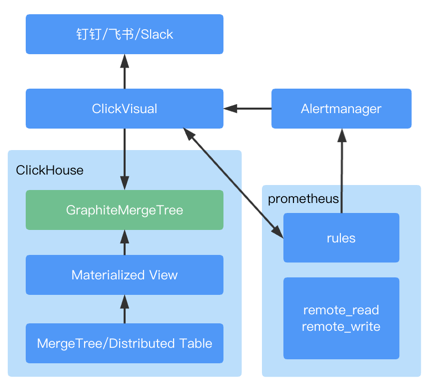
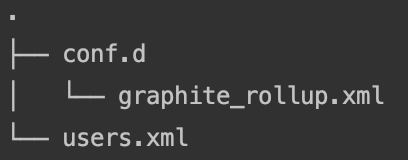
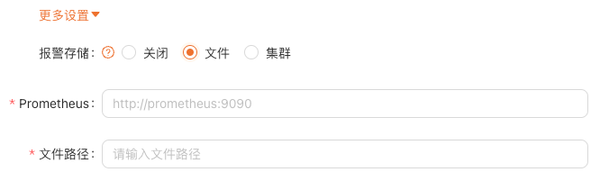
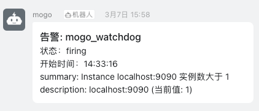

# Alarm function configuration

`Available version >= 0.2.1`

## AI Alert Analysis

For an existing deployment, run the metadata migration (`/api/v1/migration`) as part of the upgrade before enabling this feature. It creates analysis and delivery tables and adds rule cooldown and session source columns.

The full edition can generate an asynchronous AI analysis after a normal alert and send a separate message to the channels captured for that alert. Normal alerts do not wait for the model. Configure a working model in model settings, then enable the worker:

```toml
[alarm.ai]
enabled = true
cooldownSeconds = 900
```

Analysis is disabled when omitted, and the default cooldown is 900 seconds. The rule API accepts `aiCooldownSeconds`; `0` inherits the global value. Analysis runs with the rule owner's log permissions. It queries actual logs before producing a conclusion. Related-table queries must pass the same permission checks and remain within the alert time window. A model or initial evidence query failure does not produce a successful conclusion.

Root-cause investigation instructions guide the AI to follow an identified slow or timed-out dependency into its server and application logs using the same request identifiers. It should prefer tables from the same instance and environment, and avoid carrying upstream endpoint or latency filters into downstream cause queries. Ask follow-up investigations use the same instructions. Step and execution-time limits still apply. Missing access, unavailable logs, or exhausted leads must be reported as evidence gaps; a downstream timeout alone does not establish a database failure or a failed save. Current tools read integrated, authorized logs only, without automatic access to unintegrated metrics or source code.

Request identifiers may use different fields across tables or appear in arrays such as `reqIds`. When an exact field query has no results, the instructions guide the AI to search raw logs for an already observed complete request ID within the same service and time window, then correlate using the actual fields found.

The default empty condition `1=1` becomes an empty filter. Legacy aggregation SQL and other expressions that cannot be safely converted are never executed directly. Analysis instead uses samples from the same table and time window, with an explicit caveat that sample counts are not original-rule match counts and aggregation metrics were not recomputed.

Consecutive alerts with the same rule, condition, log table, and labels are merged while analysis is queued or running, and during the cooldown following a successful analysis. Reanalysis after cooldown uses a recent time window. A firing after recovery starts a new incident. Deduplication and leases are persisted in the metadata database for multiple instances. Failed analysis and individual channel deliveries have at most three attempts each. Confirmed successful channels are skipped on retries. A network timeout may occur after a receiver accepted a message, so strictly exactly-once external delivery cannot be guaranteed.

The analysis includes an Ask continuation link. Set `app.rootURL` to the user-facing deployment URL, including any subpath, such as `https://example.com/clickvisual`. The link contains only an opaque analysis identifier. Opening it requires login and current access to every evidence table; insufficient access prevents evidence import. Each authorized visit creates a personal conversation seeded with alert context, log evidence, and the AI conclusion. The URL is replaced with its `sessionId`, so refresh reopens that conversation. Different users and later visits by the same user get independent editable conversations.

Background analysis sessions do not appear in personal history. Notifications have a separate AI analysis title with the alert name, a readable analysis window (UTC+8), and sections for conclusion, key evidence, uncertainties, and recommended actions. A labeled Ask continuation link appears at the bottom. Channel messages contain a bounded summary rather than full log samples; long sections are shortened individually so later caveats and actions remain present. Authorized users can read the complete conclusion, inspect evidence, and continue the investigation in Ask.

The query-page link in Ask opens the corresponding log query in a new tab, keeping the current conversation open.

Conversations show conclusions and key evidence without automatically appending a log-sample block. Raw logs remain available through the query-page link. Queries covering up to 15 minutes run immediately when the user has permission, including queries on a different table. Longer cross-table queries and expanding the time range beyond six hours still require confirmation.

The “复制排查上下文” (Copy investigation context) icon is always visible below each AI reply. It copies the conversation, query filters, time ranges, and available log evidence up to that reply for pasting into a local AI. The icon briefly changes to a checkmark after copying. Copying does not create a share link or send data to an external AI. The action is also available in shared read-only conversations.

## Architecture 



## Instructions

1. Generate Materialized View of the corresponding data table in ClickHouse to enter data into metrics.samples in seconds according to the configured rules.
2. Write the generated Prometheus alarm rules to the configured file or configmap.
3. Prometheus reads data from metrics.samples, generate alarms according to alarm rules, and push them to Prometheus AlertManager.
4. Prometheus Alertmanager is pushed to ClickVisual through webhook, and then ClickVisual distributes it to third party communication platform such as DingDing.

## Cluster deployment

Refer to the config:[https://github.com/clickvisual/clickvisual/tree/master/data/k8s/prometheus](https://github.com/clickvisual/clickvisual/tree/master/data/k8s/prometheus)

### ClickHouse Config

Newly add `graphite_rollup` configuration,the configuration path can be slightly different according to the version of ClickHouse, and the specific configuration shall be subject to the official guidance.



```xml
<?xml version="1.0" ?>
<yandex>
    <graphite_rollup>
        <path_column_name>tags</path_column_name>
        <time_column_name>ts</time_column_name>
        <value_column_name>val</value_column_name>
        <version_column_name>updated</version_column_name>
        <default>
            <function>avg</function>
            <retention>
                <age>0</age>
                <precision>10</precision>
            </retention>
            <retention>
                <age>86400</age>
                <precision>30</precision>
            </retention>
            <retention>
                <age>172800</age>
                <precision>300</precision>
            </retention>
        </default>
    </graphite_rollup>
</yandex>
```
You need to create etrics.samples with `graphite_ Rollup` configuration

```sql
CREATE DATABASE IF NOT EXISTS metrics;
CREATE TABLE IF NOT EXISTS metrics.samples
(
    date Date DEFAULT toDate(0),
    name String,
    tags Array(String),
    val Float64,
    ts DateTime,
    updated DateTime DEFAULT now()
)ENGINE = GraphiteMergeTree(date, (name, tags, ts), 8192, 'graphite_rollup');
```

### prom2click config

prom2click repository：[https://github.com/mindis/prom2click](https://github.com/mindis/prom2click)

Modify the service startup parameter, -ch.dsn parameter to ensure that the service can access the ClickHouse.

### Prometheus config

Add the following configuration in the startup file:

- prom2click (corresponding service address)
- alertmanager (corresponding service address)

```yaml
alerting:
  # Alarm configuration file
  alertmanagers:
  # Modify: using static binding
  - static_configs:
    # Modify: targets, specified address and port
    - targets: ["alertmanager:9093"]
remote_read:
  - url: "http://prom2click:9201/read"
    read_recent: true
remote_write:
  - url: "http://prom2click:9201/write"
    queue_config:
      capacity: 10000
      max_shards: 1
      max_samples_per_send: 500
```

### Prometheus AlertManager Config

If the alarm mode is webhook, it calls back to the ClickVisual service. So you need change the url address to ensure normal access to the ClickVisual service.

```yaml
route:
  group_by: ['alertname', 'cluster', 'service']
  group_wait: 30s
  group_interval: 5m
  repeat_interval: 10m
  receiver: webhook

receivers:
- name: 'webhook'
  webhook_configs:
  - url: 'http://clickvisual:9001/api/v1/prometheus/alerts'
```

### ClickVisual Config

In the top navigation bar access:Setting -> Instances

In Create/edit instance modal,click "More Options",you can see the config to send alarm rules to Prometheus.

If Prometheus is started in the local configuration file mode, such as the following example, configure the file path as `/etc/prometheus/rules`

```yaml
rule_files:
- /etc/prometheus/rules/*.yaml
```



If deployed in k8s mode, this configmap is the location where the rules are stored.

Alarm message push effect display


