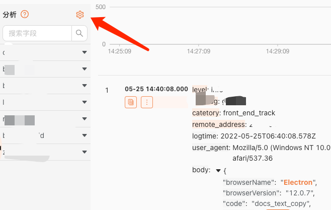
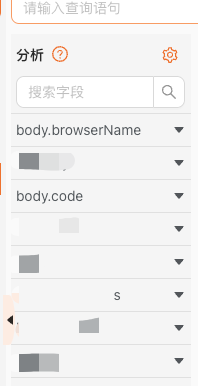
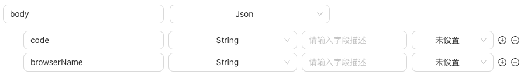
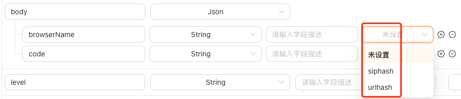
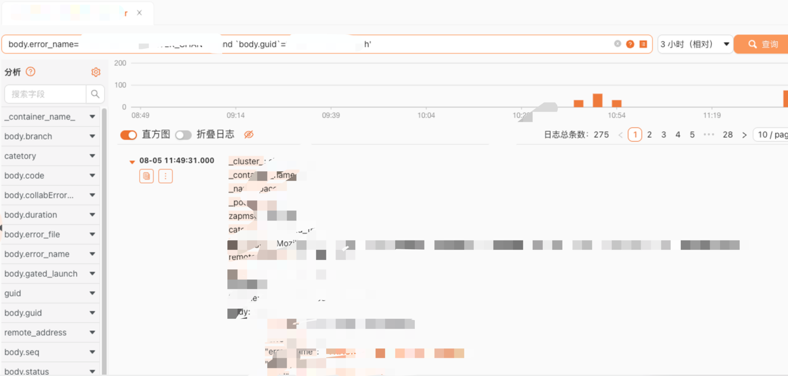

# 日志检索

日志查询条件筛选部分使用的 ClickHouse 原生 Where 子句语法。

[官方文档](https://clickhouse.com/docs/zh/sql-reference/statements/select/where)

## Ask 日志排查（v2）

ClickVisual 首页、`/v2` 和登录后的默认入口均为 Ask（`/v2/ask`），也可以从「日志 → Ask」打开。输入服务名、Trace ID 或报错，页面底部可以继续提问，左侧历史记录可以切换已保存的对话，「新对话」开始另一轮排查。示例问题只填入输入框，点击发送后才开始排查。仅提供日志查询的 private-lite 版本仍默认打开查询页。

对话保存后，地址栏会带上 `sessionId`，例如 `/v2/ask?sessionId=123`。刷新或直接打开此地址会恢复该对话，浏览器前进、后退也会切换到对应对话；访问对话仍需具备权限。「新对话」移除 `sessionId`，不带该参数时显示空白对话。原有 `/query` 入口仍跳转到 `/v2/query`，保留日志查询参数。

历史记录固定在窗口最左侧，对话区占满剩余空间。侧栏支持按标题搜索，并显示对话的更新时间，长标题可悬停查看全文。桌面默认展开侧栏，手机默认收起；点击侧栏图标展开或收起，按 Esc 收起并返回入口按钮。分享入口位于侧栏底部。

对话记录按登录用户独立保存；其他用户不能通过修改 `sessionId` 读取、续聊、确认查询或生成分享链接。AI 读取日志表列表、字段和执行查询时均使用当前用户的日志查询权限。打开历史对话、继续分析和确认查询前，会重新检查对话所涉及日志表的权限；权限撤销后，不能再读取该对话内容或将其中的日志证据交给模型继续分析。

Ask 查询条件限定为当前日志表的字段比较、`LIKE`、`IN` 和 `IS NULL`，可用 `AND`、`OR` 连接，也支持单个关键词搜索。不接受函数、子查询、SQL 注释或完整 SQL 语句，避免绕过日志表权限。

Ask 直接以对话展示回答，不显示中间工具步骤。查询返回的日志样本直接附在回复中，最多展示 8 条，内容较长时会标注截断；样本不代表全部结果。需要完整查询时，回复中的「在查询页打开」会带上日志表、条件和时间。追问具体内容时会沿用已有查询信息。切换日志表或扩大到超过 6 小时的时间范围时，页面会先要求确认。模型需由管理员在「模型配置」中配置。

模型配置支持 OpenAI 兼容（Chat Completions）、OpenAI Responses 和 Anthropic 协议。使用 Responses API 的网关应选择「OpenAI Responses」。API Key 保存在后台，页面仅显示配置状态；编辑时留空会保留已有密钥。Ask 使用后台启用的模型进行分析，给出日志证据、可能原因和下一步建议；证据不足时会说明限制。

「复制分享链接」生成 `/v2/ask/share/:token`。访问者必须登录，并具有对话所涉及全部日志表的查询权限，才能只读查看；检查包括历史日志证据、日志表列表和字段信息，不仅检查最后一次查询。分享链接不会授予日志权限，也不能用于续聊或确认查询。原来的 `/v2/troubleshoot` 和 `/v2/troubleshoot/share/:token` 链接仍可使用。部署在子路径时，在上述路径前加上部署前缀。

## 从阿里云迁移过来后的使用案例

例如我们以前利用阿里云的模糊匹配进行搜索，以下语句会对这两个条件进行模糊匹配

`Electron and docs_text_copy`

那么在 ClickVisual 中如何使用呢，在默认情况下（通过 ClickVisual 建立整套的数据采集流程），使用以下语句进行模糊匹配可以达到相同效果

`_raw_log_ like '%Electron%' and _raw_log_ like '%docs_text_copy%'`

但是这样性能不太好，那么可以设置分析字段来提升查询效率  
假设我们匹配的目标字段在嵌套的 json 中：body 内的 browserName 和 code 字段。如下图

如果在左侧的分析界面看到了如下的配置，可直接使用以下语句进行查询

`body.browserName='browserName' and body.code='docs_text_copy'`

如果没有配置分析字段，则需要进行相关的配置

完成配置后，查询语句为：

`body.browserName='browserName' and body.code='docs_text_copy'`

这种情况下查询依旧很花时间，感觉很慢，可以开启下面的配置，这里设置 siphash 和 urlhash(会截断?后的参数进行hash)，通过建立 hash 映射，提升查询效率。

查询语句依旧是：

`body.browserName='browserName' and body.code='docs_text_copy'`

